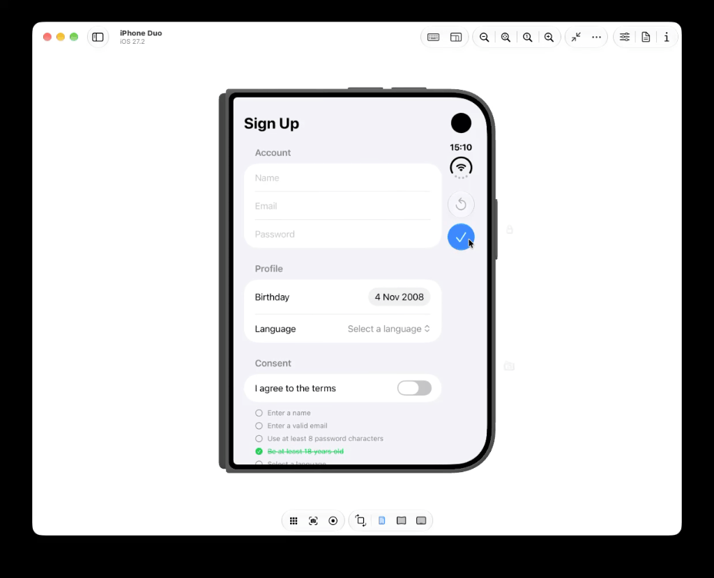

<p align="center">
  
</p>

<h1 align="center">Formidable</h1>

<p align="center">Simple, declarative form validation for SwiftUI.</p>

<p align="center">
  <a href="https://swift.org"></a>
  <a href="https://www.swift.org/documentation/package-manager/"></a>
  <a href="LICENSE"></a>
</p>

<p align="center">
  
</p>

---

## Contents

- [What is Formidable?](#what-is-formidable)
- [Requirements](#requirements)
- [Installation](#installation)
- [Quick Start](#quick-start)
- [Core Concepts](#core-concepts)
- [Validation Rules](#validation-rules)
- [Transforming Values](#transforming-values)
- [Hiding and Disabling Fields](#hiding-and-disabling-fields)
- [Customizing Error Messages](#customizing-error-messages)
- [Agent Skill (Codex)](#-agent-skill-codex)

---

## What is Formidable?

Formidable helps you build forms in SwiftUI without writing validation logic by hand. You:

1. Describe each field and the rules it must follow.
2. Connect the fields to your SwiftUI controls with `.field(...)`.
3. Call `validate()` when the user taps **Save**.

Formidable shows the error messages under each control, tracks what changed, and can reset the form to its original values.

---

## Requirements

| Platforms | Swift | Xcode |
| --- | --- | --- |
| iOS 17+, macOS 15+, tvOS 17+ | 6.2 | 26+ |

---

## Installation

Formidable is distributed with **Swift Package Manager**.

**In Xcode:** choose **File › Add Package Dependencies…**, paste the URL below, and add the `Formidable` library to your target.

```text
https://github.com/didisouzacosta/Formidable
```

**In `Package.swift`:**

```swift
dependencies: [
    .package(url: "https://github.com/didisouzacosta/Formidable", .upToNextMajor(from: "1.4.0"))
]
```

---

## Quick Start

Let's build a sign-up form with a name and an age. It takes three steps.

### Step 1: Describe your errors

Each rule needs an error to throw when the value is invalid. Use `LocalizedError` so the message shown on screen is readable.

```swift
import Foundation

enum ValidationError: LocalizedError {
    case isRequired
    case ageTooLow

    var errorDescription: String? {
        switch self {
        case .isRequired: "This field cannot be left empty."
        case .ageTooLow: "You need to be at least 18 years old."
        }
    }
}
```

### Step 2: Create the form

A form is an `@Observable` class that conforms to `Formidable`. Each property is a `FormField` with an initial value and a list of rules.

```swift
import Formidable
import Observation

@Observable
final class UserForm: Formidable {

    var nameField = FormField("", rules: [RequiredRule(ValidationError.isRequired)])
    var ageField = FormField(0, rules: [GreaterThanOrEqualRule(18, error: ValidationError.ageTooLow)])

    func submit() throws -> (name: String, age: Int) {
        try validate()
        return (nameField.value, ageField.value)
    }

}
```

### Step 3: Connect it to SwiftUI

Bind each control to `field.value`, then add `.field(...)` to show the errors under the control.

```swift
import Formidable
import SwiftUI

struct UserFormView: View {

    @State private var form = UserForm()

    var body: some View {
        NavigationStack {
            Form {
                TextField("Name", text: $form.nameField.value)
                    .field($form.nameField, accessibilityLabel: "Name errors")

                Picker("Age", selection: $form.ageField.value) {
                    ForEach([10, 18, 36], id: \.self) { age in
                        Text("\(age)")
                    }
                }
                .field($form.ageField, accessibilityLabel: "Age errors")
            }
            .navigationTitle("Sign Up")
            .toolbar {
                Button("Reset", action: form.reset)
                Button("Save", action: save)
            }
        }
    }

    private func save() {
        do {
            let user = try form.submit()
            print("Saved:", user)
        } catch {
            print("Invalid form:", error.localizedDescription)
        }
    }

}
```

That's it. Tap **Save** with an empty name and the message *"This field cannot be left empty."* appears under the text field.

> **When do errors appear?** A field's errors stay hidden until the user changes its value or you call `validate()`. Both set the field's `showErrors` to `true`. `reset()` hides them again.

---

## Core Concepts

### `FormField`

A `FormField` holds one value of the form and everything Formidable needs to know about it.

| Property | What it does |
| --- | --- |
| `value` | The current value. Bind your control to it. |
| `originalValue` | The value the field started with, used to detect changes. |
| `isModified` | `true` when `value` is different from `originalValue`. |
| `rules` | The validation rules the value must pass. |
| `errors` | The errors produced by the rules right now. |
| `isValid` | `true` when there are no errors. |
| `showErrors` | Whether the errors should be displayed. |
| `transform` | An optional closure that normalizes the value (see [Transforming Values](#transforming-values)). |
| `isHidden` / `isDisabled` | Hide or disable the field (see [Hiding and Disabling Fields](#hiding-and-disabling-fields)). |

You can create a field from a plain value, or from a `Binding` when the value lives somewhere else:

```swift
let name = FormField("Jules")              // stores the value itself
let email = FormField($user.email)         // reads and writes user.email
```

### `Formidable`

Any class that conforms to `Formidable` automatically finds its `FormField` properties and gets these members for free:

| Member | What it does |
| --- | --- |
| `validate()` | Shows the errors of every field and throws the first one found. |
| `reset()` | Restores every field to its original value and hides the errors. |
| `isValid` | `true` when every field is valid. |
| `isModified` | `true` when any field was changed. |
| `errors` | All current errors, from every field. |
| `isDisabled` | `true` when every field is disabled. |

> Hidden or disabled fields never produce errors, so they never block `validate()`.

---

## Validation Rules

Pass rules when you create a field, or change them later through `field.rules`. Every rule receives the error it should throw.

| Rule | Passes when the value… | Example |
| --- | --- | --- |
| `RequiredRule` | is not `nil` and not empty | `RequiredRule(ValidationError.isRequired)` |
| `EmailRule` | is a valid email address | `EmailRule(ValidationError.invalidEmail)` |
| `MinLengthRule` | has at least *n* characters/items | `MinLengthRule(8, error: ValidationError.tooShort)` |
| `MaxLengthRule` | has at most *n* characters/items | `MaxLengthRule(20, error: ValidationError.tooLong)` |
| `EqualRule` | is equal to a value | `EqualRule(true, error: ValidationError.acceptTerms)` |
| `GreaterThanRule` | is greater than a value | `GreaterThanRule(0, error: ValidationError.mustBePositive)` |
| `GreaterThanOrEqualRule` | is greater than or equal to a value | `GreaterThanOrEqualRule(18, error: ValidationError.ageTooLow)` |
| `LessThanRule` | is less than a value | `LessThanRule(100, error: ValidationError.tooHigh)` |
| `LessThanOrEqualRule` | is less than or equal to a value | `LessThanOrEqualRule(Date.now, error: ValidationError.futureDate)` |
| `ContainsRule` | is in a list | `ContainsRule(in: ["BR", "US"], error: ValidationError.unsupported)` |
| `UniqueRule` | is **not** in a list | `UniqueRule(in: takenUsernames, error: ValidationError.taken)` |

A field can have several rules. They are all checked, and every failure becomes an error:

```swift
var passwordField = FormField(
    "",
    rules: [
        RequiredRule(ValidationError.isRequired),
        MinLengthRule(8, error: ValidationError.tooShort)
    ]
)
```

### Comparing two fields

Sometimes a rule depends on another field, like *"confirm password"*. Use the `KeyPath` versions of the rules: `EqualKeyPathRule`, `GreaterThanKeyPathRule`, `GreaterThanOrEqualKeyPathRule`, `LessThanKeyPathRule`, `LessThanOrEqualKeyPathRule`, `ContainsKeyPathRule` and `UniqueKeyPathRule`. They read the reference value every time they validate, so they always compare against the latest value.

```swift
@Observable
final class PasswordForm: Formidable {

    var passwordField: FormField<String>
    var confirmationField: FormField<String>

    init() {
        let password = FormField("", rules: [MinLengthRule(8, error: ValidationError.tooShort)])

        passwordField = password
        confirmationField = FormField(
            "",
            rules: [EqualKeyPathRule(password, keyPath: \.value, error: ValidationError.passwordsDontMatch)]
        )
    }

}
```

> Point the rule at the other **field** (as above), not at the form itself, so the form and its rules don't keep each other alive in memory.

---

## Transforming Values

Use `transform` to clean up a value before it is read and validated, for example to trim spaces or lowercase an email:

```swift
var emailField = FormField(
    "",
    rules: [EmailRule(ValidationError.invalidEmail)],
    transform: { $0.trimmingCharacters(in: .whitespaces).lowercased() }
)
```

`emailField.value` always returns the transformed text, and the rules validate that same text.

---

## Hiding and Disabling Fields

Change `isHidden` or `isDisabled` and the control updates automatically. Hidden and disabled fields are skipped during validation.

```swift
form.companyField.isHidden = !form.isBusinessAccount
form.emailField.isDisabled = true
```

---

## Customizing Error Messages

By default, Formidable lists the error messages under each control in **red**, using the **`callout`** font. You can change that look (a smaller font, another color, an icon, a different layout) with an **error style**.

### Step 1: Create a style

A style is a type that conforms to `FormFieldErrorStyle`. It has a single method, `makeBody(configuration:)`, which returns the view that displays the messages.

```swift
import Formidable
import SwiftUI

struct CompactErrorStyle: FormFieldErrorStyle {

    func makeBody(configuration: Configuration) -> some View {
        Text(configuration.messages.joined(separator: "\n"))
            .font(.caption)
            .foregroundStyle(.red)
    }

}
```

The `configuration` gives you two things:

| Property | What it contains |
| --- | --- |
| `messages` | The text of each visible error, ready to display. |
| `errors` | The original error values, so you can check which error happened. |

`makeBody` is only called when there is at least one error, so you don't need to handle the empty case.

### Step 2: Apply the style

Add `.formFieldErrorStyle(_:)` to any view. The style applies to **every** `.field(...)` inside that view.

**The whole form** (most common):

```swift
Form {
    TextField("Name", text: $form.nameField.value)
        .field($form.nameField, accessibilityLabel: "Name errors")

    TextField("Email", text: $form.emailField.value)
        .field($form.emailField, accessibilityLabel: "Email errors")
}
.formFieldErrorStyle(CompactErrorStyle())
```

**The whole app**, by applying it to the root view:

```swift
@main
struct MyApp: App {
    var body: some Scene {
        WindowGroup {
            ContentView()
                .formFieldErrorStyle(CompactErrorStyle())
        }
    }
}
```

**A single field**:

```swift
TextField("Name", text: $form.nameField.value)
    .field($form.nameField, accessibilityLabel: "Name errors")
    .formFieldErrorStyle(CompactErrorStyle())
```

The closest style wins. To go back to the default look inside a styled area, use `.automatic`:

```swift
Form {
    TextField("Name", text: $form.nameField.value)
        .field($form.nameField, accessibilityLabel: "Name errors")
        .formFieldErrorStyle(.automatic) // default red callout

    TextField("Email", text: $form.emailField.value)
        .field($form.emailField, accessibilityLabel: "Email errors") // compact
}
.formFieldErrorStyle(CompactErrorStyle())
```

### Step 3 (optional): Make the style configurable

A style is a regular struct, so it can have properties. This lets you reuse the same style with different settings:

```swift
struct IconErrorStyle: FormFieldErrorStyle {

    var font: Font = .footnote
    var color: Color = .red

    func makeBody(configuration: Configuration) -> some View {
        VStack(alignment: .leading, spacing: 4) {
            ForEach(configuration.messages.indices, id: \.self) { index in
                Label(configuration.messages[index], systemImage: "exclamationmark.circle.fill")
            }
        }
        .font(font)
        .foregroundStyle(color)
    }

}

Form { ... }
    .formFieldErrorStyle(IconErrorStyle(font: .caption, color: .orange))
```

### Reacting to specific errors

Use `configuration.errors` when a style should behave differently for a given error. For example, show a warning icon only for weak passwords:

```swift
struct PasswordErrorStyle: FormFieldErrorStyle {

    func makeBody(configuration: Configuration) -> some View {
        let isWeak = configuration.errors.contains { ($0 as? ValidationError) == .tooShort }

        Label(
            configuration.messages.joined(separator: "\n"),
            systemImage: isWeak ? "exclamationmark.triangle.fill" : "xmark.circle.fill"
        )
        .font(.caption)
        .foregroundStyle(isWeak ? .orange : .red)
    }

}
```

### Good to know

- **Accessibility is handled for you.** Whatever your style looks like, Formidable groups the messages into one accessibility element, reads them with the `accessibilityLabel` you passed to `.field(...)`, and keeps VoiceOver working.
- **Keep messages visible.** Use colors with enough contrast and fonts that scale with Dynamic Type, such as `.caption` or `.footnote`, instead of fixed sizes.
- **Styles must be `Sendable`.** Structs with simple properties like `Font`, `Color`, `Bool` or `String` already are.

---

## 🤖 Agent Skill (Codex)

This repository includes the **`formidable-expert`** Agent Skill. It teaches Codex the Formidable patterns, so it can write new rules and forms the way this project expects.

### Installation

Ask Codex to install the [`formidable-expert`](formidable-expert) skill directly from this repository:

```text
Use $skill-installer to install the formidable-expert skill from https://github.com/didisouzacosta/Formidable/tree/main/formidable-expert
```

Codex detects new skills automatically. If the skill does not appear, restart Codex. Skills work in the Codex desktop app, CLI and IDE extension. See the [Codex Agent Skills documentation](https://learn.chatgpt.com/docs/build-skills) for more options.

### How to use

Mention `$formidable-expert` in your request, or let Codex pick it automatically when your request matches. For example:

- "Use `$formidable-expert` to create a new validation rule for CNPJ."
- "Use `$formidable-expert` to migrate this SwiftUI form to the Formidable pattern."
- "Use `$formidable-expert` to show how to structure a form with cross-validation."

In the CLI or IDE extension, run `/skills` or type `$` to browse the available skills.
